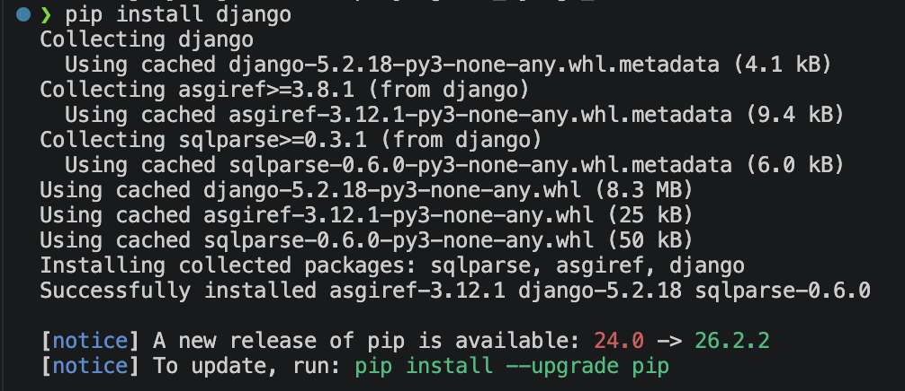
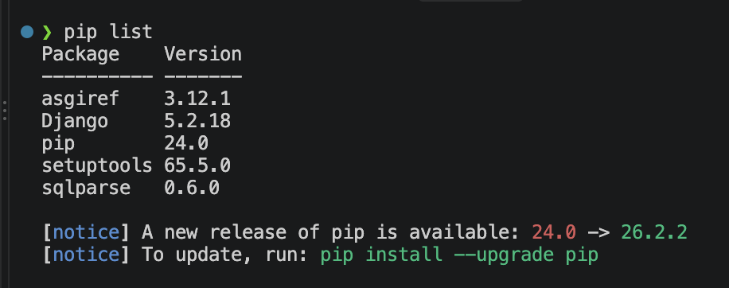
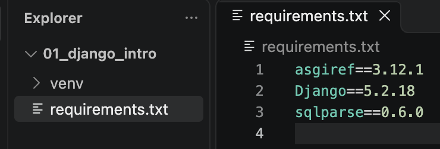
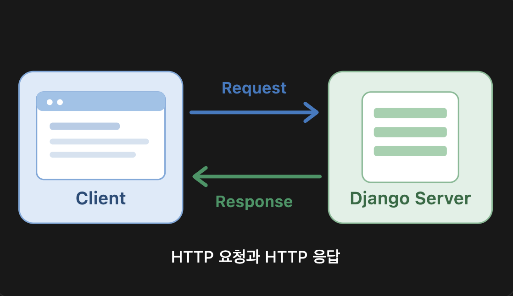
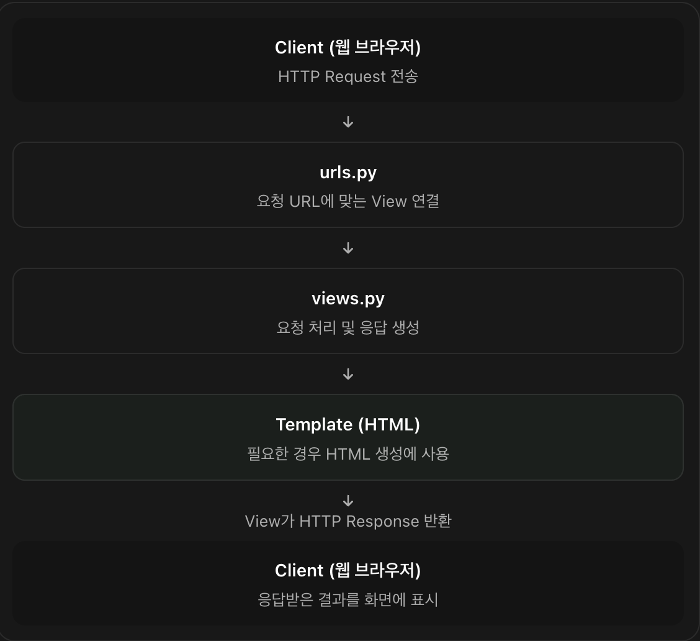
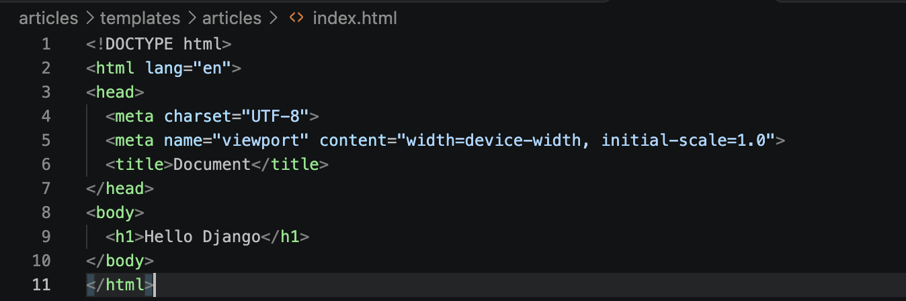
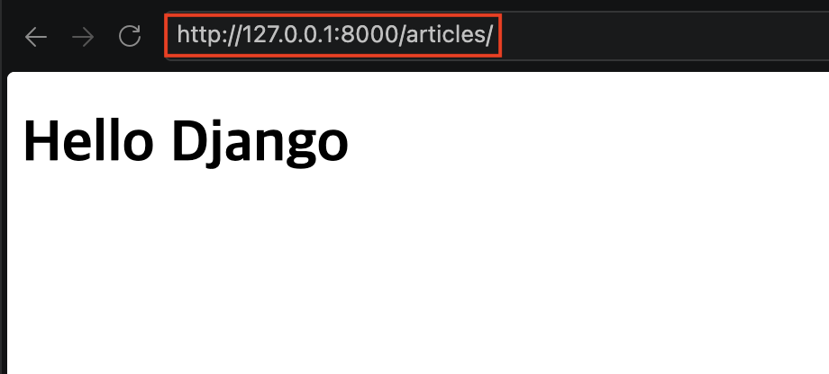
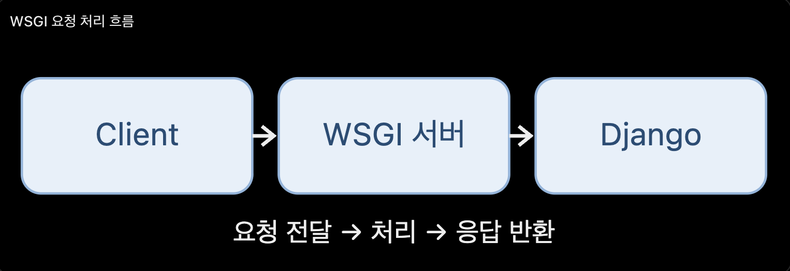
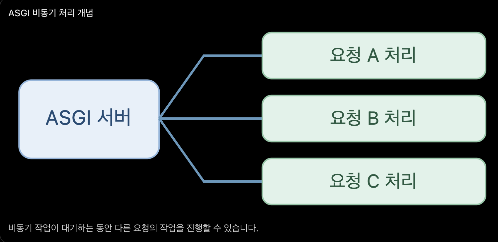

## 0. Django Framework

**Django란?**

Django는 Python 프로그래밍 언어를 기반으로 웹 애플리케이션을 효율적으로 개발할 수 있도록 다양한 기능을 제공하는 웹 프레임워크(Web Framework)

**Django의 주요 특징**

- Python 기반 : Python 언어를 사용하여 웹 애플리케이션 개발
- MTV 패턴 : Model, View, Template으로 역할을 분리
- ORM 지원 : Python 코드를 사용하여 데이터베이스 조작
- 기본 기능 제공 : URL Routing, 사용자 인증, 관리자 페이지, 보안 기능 등
- Project와 App 구조 : 하나의 프로젝트 안에서 기능별로 여러 앱을 구성할 수 있음

**Django의 MTV 패턴**

|구성 요소|역할|
|:---:|---|
|Model|데이터베이스와 관련된 데이터 구조 및 처리|
|View|클라이언트의 요청 처리 및 응답 생성|
|Template|사용자에게 보여줄 HTML 화면 구성|

**Django의 기본 동작 흐름**

1. Client -> Django 서버에 HTTP 요청
2. URL Dispatcher -> 요청 URL에 해당하는 View 연결
3. View -> 요청 처리 및 필요시 Model을 통해 데이터 조회
4. Template -> 전달받은 데이터를 활용하여 HTML 생성
5. Response -> 클라이언트에 HTTP 응답

| Model과 Template은 필요한 경우에 사용된다.

**Django Project 와 App**

- Project : Django 웹 애플리케이션의 전체 설정과 구성을 관리하는 단위
- App : 게시글, 회원 관리 등 특정 기능을 담당하는 단위

## 1. 가상환경 설치 및 활성화/비활성화

```bash
# 1. 가상환경 설치
python -m venv venv₩
# macOS 가상환경 설치
python3 -m venv venv

# 2. 가상환경 활성화
source venv/Scripts/activate
# macOS 가상환경 활성화
source venv/bin/activate
echo $VIRTUAL_ENV # 경로 출력 = 활성화, 경로 미출력 = 비활성화

# 3. 가상환경 비활성화
deactivate
```

## 2. 가상환경에 django install

```bash
# 가상환경이 활성화 된 상태 기준
# 1. django 설치
pip install django

# 2. 가상환경에 설치된 의존성 패키지 확인
pip list

# 3. 의존성 기록
pip freeze > requirements.txt

# 4. 의존성 가져오기
pip install -r requirements.txt
```







## 3. Django 프로젝트 생성 및 서버 실행

```bash
# 프로젝트 생성
django-admin startproject firstpjt .

# 서버 실행
python manage.py runserver
```


## 4. 요청(Request)와 응답(Response)

Django는 Client의 요청(Request)을 받아 처리하고, 그 결과를 응답(Response) 으로 반환하는 웹 프레임워크

**요청과 응답이란?**

- 요청(Request) : 클라이언트가 서버에 특정 작업을 요청하는 것
- 응답(Response) : 서버가 클라이언트의 요청을 처리한 후 결과를 반환하는 것



> 게시판 접속 상황의 예시
> 
> 1. 사용자가 브라우저에서 게시글 목록 URL에 접속
> 2. 브라우저가 Django 서버에 HTTP 요청 전송
> 3. Django 서버가 요청을 처리
> 4. Django 서버가 HTML 등의 결과를 HTTP 응답으로 반환
> 5. 브라우저가 응답받은 HTML을 화면에 표시
>

**Django 요청 처리 과정**



실제로는 View가 필요애 따라 데이터베이스의 데이터를 조회하거나 저장하기 위해 `modles.py` 를 사용할 수 있음

**Django 요청과 응답 코드 예시**

1. URL 요청 연결

```python
# firstpjt/urls.py

# 클라이언트가 'articles/' URL로 요청하면 views.py 의 index 함수를 실행하도록 연결

from django.contrib import admin
from django.urls import path
# 프로젝트 내 app 디렉토리의 views 모델 추가
from articles import views

urlpatterns = [
  path('admin/', admin.site.urls),
  path('articles/', views.index),
]
```

2. 요청 처리

```python
# articles/views.py

# Django의 View 함수는 요청 객체를 전달하고, 응답 객체를 반환

# request : 클라이언트가 보낸 HTTP 요청 객체를 담은 객체
# render() : 템플릿을 이용하여 HTML 응답을 생성하는 함수
# "articles/index.html" : 응답에 사용할 HTML 템플릿

from django.shortcuts import render

def index(request):
  return render(request, "articles/index.html")
```

3. HTML 템플릿

```HTML
<!--Django는 해당 템플릿을 이용해 HTML 응답을 생성하고 클라이언트에게 반환-->
<!DOCTYPE html>
<html>
<head>
  <title>게시판</title>
</head>
<body> 
  <h1>게시글 목록</h1>
</body>
</html>
```

**요청과 응답에 사용하는 주요 객체**

|구분|Django 객체|역할|
|:---:|:---:|---|
|요청 (Request)|`HttpRequest`|클라이언트의 요청 정보 저장|
|응답 (Response)|`HttpResponse`|클라이언트에게 변환할 응답 정보 저장|

```python
# HTML 템플릿을 사용하지 않고 직접 응답할 수도 있음

from django.http import HttpResponse

def index(request):
  return HttpResponse("Hello Django")
```

**실제 요청과 응답 흐름**

_HTML 템플릿 사용_


서버 실행 후 http://127.0.0.1:8000/articles/ URL 경로로 요청 전달


HTML 템플릿을 사용하려면 기본 설정에서는 `templates` 라는 이름의 디렉터리를 사용해야 함

정확히는 `templates` 디렉터리는 앱 내부에서도 생성할 수 있고, 프로젝트 공통 디렉터리로도 생성할 수 있다

단, `templates` 라는 이름이 모든 상황에서 강제되는 것이 아닌. 프로젝트의 `settings.py` 에서 `TEMPLATES` 의 `DIRS` 설정을 변경하면 다른 이름의 디렉터리로도 사용할 수 있음





---

_HttpResponse 객체 사용_

서버 실행 후 http://127.0.0.1:8000/nonetemplate/ URL 경로로 요청 전달


---

**HTML 템플릿 vs HttpResponse 객체 차이**

Django에서는 클라이언에게 응답을 반환할 때 `HttpResponse()` 와 `render()` 를 사용할 수 있음

1. **HttpRespnse()**
- HTTP 응답 객체를 직접 생성하는 클래스
- 응답할 내용을 직접 작성하여 반환
- HTML 템플릿을 자동으로 사용하지 않음

```python
from django.http import HttpResponse

def index(request):
  return HttpResponse("<h1>Hello Django!</h1>")
```

2. **render()**
- HTML 템플릿을 렌더링하여 HTML 응답을 생성하는 함수
- 별도의 HTML 템플릿 파일을 사용
- `context` 를 통해 HTML 템플릿에 데이터 전달 가능
- 최종적으로 `HttpRespnse` 객체 반환

```python
from django.shortcuts import render

def index(request):
  return render(request, "articles/index.html")
```

**요약**

|구분|`HttpRespnse()`|`render()`|
|:---:|---|---|
|종류|클래스|함수|
|응답 생성|응답 내용 직접 생성|HTML 템플릿 렌더링|
|HTML 템플릿|자동 사용 X|사용 O|
|반환객체|HttpRespnse|HttpResonse|

## 5. WSGI와 ASGI

Django 프로젝트 디렉터리 하위에 `wsgi.py` 와 `asgi.py` 는 각각 WSGI 서버와 Django 연결, ASGI 서버와 Django 연결

WSGI, ASGI는 클라이언트의 HTTP 요청을 받아 Django 애플리케이션에 전달하고, Django가 처리한 응답을 클라이언트에 전달하는 역할을 수행

**두 방식의 가장 큰 차이는 동기(Synchronous) 방식과 비동기(Asynchronous) 방식의 지원 여부**

**WSGI (Web Server Gateway Interface)**



Python 웹 서버와 웹 애플리케이션을 연결하기 위한 표준 인터페이스

주로 동기 방식의 요청 처리를 위해 설계

- **동기 방식 중심** : 일반적으로 요청을 처리하는 동안 해당 실행 흐름은 작업이 끝날 때까지 기다림
- **HTTP 요청 처리** : 일반적인 웹 페이지 조회, 게시글 CRUD 등의 기능에 적합
- **대표적인 서버** : Gunicorn, uWSGI

1. 클라이언트가 게시글 목록을 요청
2. WSGI 서버가 Django에 요청을 전달
3. Django의 View 함수가 요청을 처리
4. 처리된 결과를 WSGI 서버를 통해 클라이언트에 반환

---

**ASGI (Asynchronous Server Gateway Interface)**



WSGI의 한계를 보완하여 비동기 처리와 장시간 유지되는 연결을 지원하도록 설계된 인터페이스

- **동기 및 비동기 지원** : 동기 코드와 비동키 코드를 모두 처리할 수 있음
- **다양한 통신 프로토콜** : HTTP뿐 아니라 WebSocket 등의 연결도 지원
- **대표적인 서버** : Uvicorn, Daphen, Hypercorn

단, ASGI를 사용한다고 모든 Django 코드가 자동으로 비동기가 되는 것이 아님

**WSGI와 ASGI 비교 요약**

|구분|WSGI|ASGI|
|---|---|---|
|명칭|Web Server Gateway Interface|Asynchronous Server Gateway Interface|
|처리 방식|동기 중심|동기 + 비동기|
|HTTP|지원|지원|
|WebSocket|표준에서 미지원|지원
|활동 예시|일반적인 웹 서비스|일반 웹 서비스, 실시간 통신|

---

## 6. 프로젝트 `Settings.py` 추가 정보

> #### 1. 한국어를 기본 언어로 변경하는 방법
> - `settings.py` 파일에서 `LANGUAGE_CODE` 를 수정
> ```python
># 변경 전
>LANGUAGE_CODE = 'en-us'
>
>TIME_ZONE = 'UTC'
>
>USE_I18N = True
>
>USE_TZ = True
> ```
>---
>```python
># 변경 후
>LANGUAGE_CODE = 'ko-kr'
>
>TIME_ZONE = 'Asia/Seoul'
>
>USE_I18N = True
>
>USE_TZ = True
>```
>각 설정의 의미
>
>|설정|설명|
>|---|---|
>|`LANGUAGE_CODE = 'ko-kr'`|Django의 기본 언어를 한국어로 설정|
>|`TIME_ZONE = 'Asia/Seoul'`|기본 시간대를 한국 표준시로 설정|
>|`USE_I18N = True`|Django의 다국어 번역 기능 활성화|
>|`USE_TZ = True`|시간대 정보를 고려한 날짜 및 시간 처리 활성화|
>
> 적용 결과
>
> 설정을 변경하면 Django에서 제공하는 번역 가능한 기본 메시지들이 한국어로 표시됨
>
> 예를 들면 Django 관리자 페이지 (`/admin/`)의 로그인 확인이나 기본 안내 메시지가 한국어로 표시될 수 있다.
>
>단, 개발자가 직접 작성흰 HTML 자동으로 한국어로 번역되는 것은 아님
>
> ---
>
>**핵심 정리** : Django 프로젝트에서 한국어를 기본 언어로 사용하려면
>
> `settings.py` 의 `LANGUAGE_CODE = 'ko-kr'` 로 변경하면 됨.
>
> 한국 시간대까지 적용하려면 `TIME_ZONE = 'Asia/Seoul'` 도 함께 설정하면 됨


