## 0. Django Framework

**Django란?**

Django는 Python 프로그래밍 언어를 기반으로 웹 애플리케이션을 효율적으로 개발할 수 있도록 다양한 기능을 제공하는 웹 프레임워크(Web Framework)

**Django의 주요 특징**

- Python 기반 : Python 언어를 사용하여 웹 애플리케이션 개발
- MTV 패턴 : Model, View, Template으로 역할을 분리
- ORM 지원 : Python 코드를 사용하여 데이터베이스 조작
- 기본 기능 제공 : URL Routing, 사용자 인증, 관리자 페이지, 보안 기능 등
- Project와 App 구조 : 하나의 프로젝트 안에서 기능별로 여러 앱을 구성할 수 있음

**Django의 MTV 패턴**

|구성 요소|역할|
|:---:|---|
|Model|데이터베이스와 관련된 데이터 구조 및 처리|
|View|클라이언트의 요청 처리 및 응답 생성|
|Template|사용자에게 보여줄 HTML 화면 구성|

**Django의 기본 동작 흐름**

1. Client -> Django 서버에 HTTP 요청
2. URL Dispatcher -> 요청 URL에 해당하는 View 연결
3. View -> 요청 처리 및 필요시 Model을 통해 데이터 조회
4. Template -> 전달받은 데이터를 활용하여 HTML 생성
5. Response -> 클라이언트에 HTTP 응답

| Model과 Template은 필요한 경우에 사용된다.

**Django Project 와 App**

- Project : Django 웹 애플리케이션의 전체 설정과 구성을 관리하는 단위
- App : 게시글, 회원 관리 등 특정 기능을 담당하는 단위

## 1. 가상환경 설치 및 활성화/비활성화

```bash
# 1. 가상환경 설치
python -m venv venv₩
# macOS 가상환경 설치
python3 -m venv venv

# 2. 가상환경 활성화
source venv/Scripts/activate
# macOS 가상환경 활성화
source venv/bin/activate
echo $VIRTUAL_ENV # 경로 출력 = 활성화, 경로 미출력 = 비활성화

# 3. 가상환경 비활성화
deactivate
```

## 2. 가상환경에 django install

```bash
# 가상환경이 활성화 된 상태 기준
# 1. django 설치
pip install django

# 2. 가상환경에 설치된 의존성 패키지 확인
pip list

# 3. 의존성 기록
pip freeze > requirements.txt

# 4. 의존성 가져오기
pip install -r requirements.txt
```

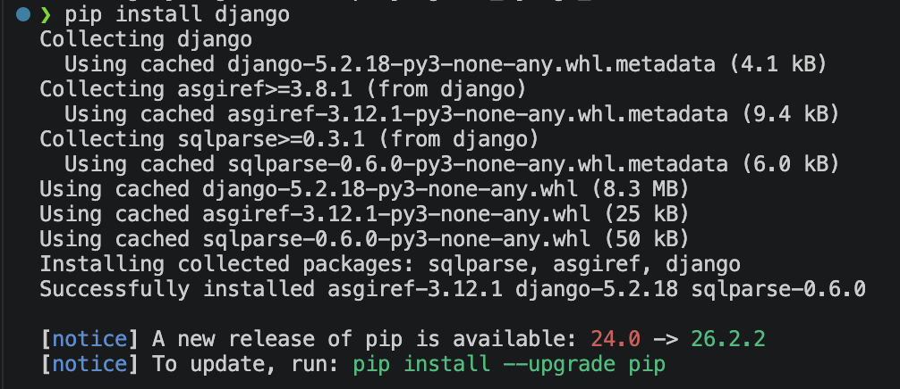

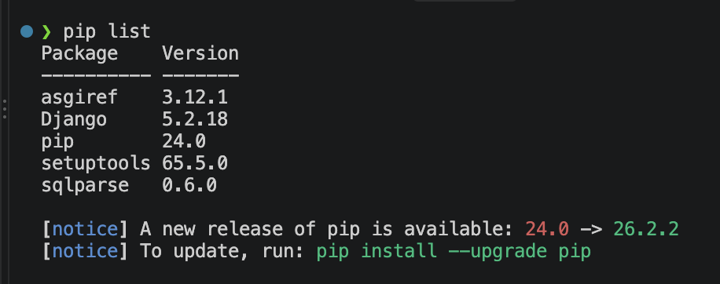

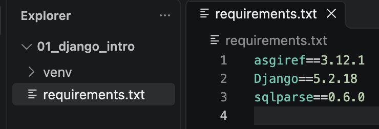

## 3. Django 프로젝트 생성 및 서버 실행

```bash
# 프로젝트 생성
django-admin startproject firstpjt .

# 서버 실행
python manage.py runserver
```


## 4. 요청(Request)와 응답(Response)

Django는 Client의 요청(Request)을 받아 처리하고, 그 결과를 응답(Response) 으로 반환하는 웹 프레임워크

**요청과 응답이란?**

- 요청(Request) : 클라이언트가 서버에 특정 작업을 요청하는 것
- 응답(Response) : 서버가 클라이언트의 요청을 처리한 후 결과를 반환하는 것

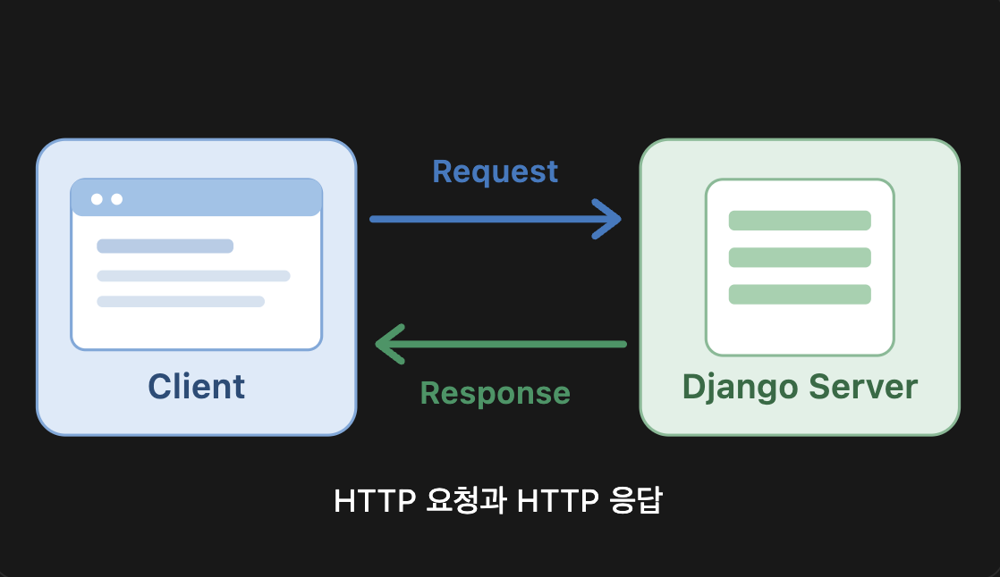

> 게시판 접속 상황의 예시
> 
> 1. 사용자가 브라우저에서 게시글 목록 URL에 접속
> 2. 브라우저가 Django 서버에 HTTP 요청 전송
> 3. Django 서버가 요청을 처리
> 4. Django 서버가 HTML 등의 결과를 HTTP 응답으로 반환
> 5. 브라우저가 응답받은 HTML을 화면에 표시
>

**Django 요청 처리 과정**

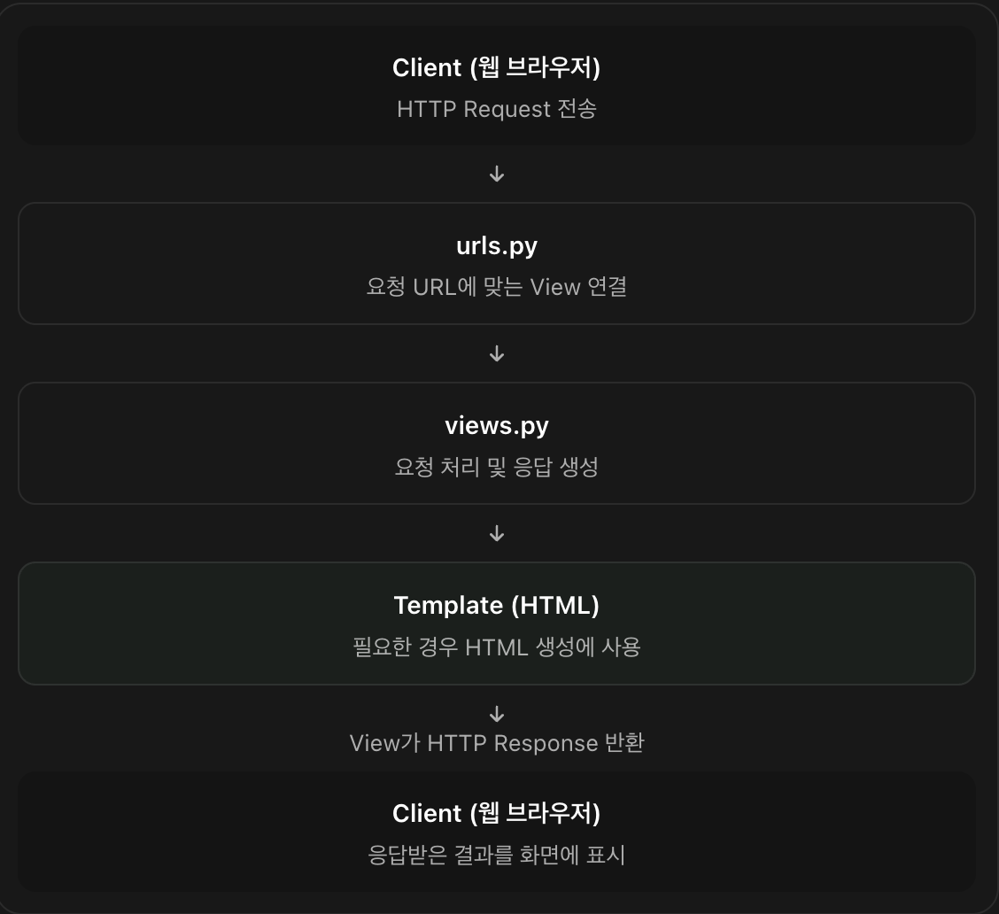

실제로는 View가 필요애 따라 데이터베이스의 데이터를 조회하거나 저장하기 위해 `modles.py` 를 사용할 수 있음

**Django 요청과 응답 코드 예시**

1. URL 요청 연결

```python
# firstpjt/urls.py

# 클라이언트가 'articles/' URL로 요청하면 views.py 의 index 함수를 실행하도록 연결

from django.contrib import admin
from django.urls import path
# 프로젝트 내 app 디렉토리의 views 모델 추가
from articles import views

urlpatterns = [
  path('admin/', admin.site.urls),
  path('articles/', views.index),
]
```

2. 요청 처리

```python
# articles/views.py

# Django의 View 함수는 요청 객체를 전달하고, 응답 객체를 반환

# request : 클라이언트가 보낸 HTTP 요청 객체를 담은 객체
# render() : 템플릿을 이용하여 HTML 응답을 생성하는 함수
# "articles/index.html" : 응답에 사용할 HTML 템플릿

from django.shortcuts import render

def index(request):
  return render(request, "articles/index.html")
```

3. HTML 템플릿

```HTML
<!--Django는 해당 템플릿을 이용해 HTML 응답을 생성하고 클라이언트에게 반환-->
<!DOCTYPE html>
<html>
<head>
  <title>게시판</title>
</head>
<body> 
  <h1>게시글 목록</h1>
</body>
</html>
```

**요청과 응답에 사용하는 주요 객체**

|구분|Django 객체|역할|
|:---:|:---:|---|
|요청 (Request)|`HttpRequest`|클라이언트의 요청 정보 저장|
|응답 (Response)|`HttpResponse`|클라이언트에게 변환할 응답 정보 저장|

```python
# HTML 템플릿을 사용하지 않고 직접 응답할 수도 있음

from django.http import HttpResponse

def index(request):
  return HttpResponse("Hello Django")
```

**실제 요청과 응답 흐름**

_HTML 템플릿 사용_


서버 실행 후 http://127.0.0.1:8000/articles/ URL 경로로 요청 전달


HTML 템플릿을 사용하려면 기본 설정에서는 `templates` 라는 이름의 디렉터리를 사용해야 함

정확히는 `templates` 디렉터리는 앱 내부에서도 생성할 수 있고, 프로젝트 공통 디렉터리로도 생성할 수 있다

단, `templates` 라는 이름이 모든 상황에서 강제되는 것이 아닌. 프로젝트의 `settings.py` 에서 `TEMPLATES` 의 `DIRS` 설정을 변경하면 다른 이름의 디렉터리로도 사용할 수 있음

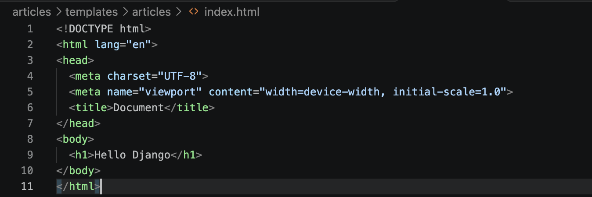

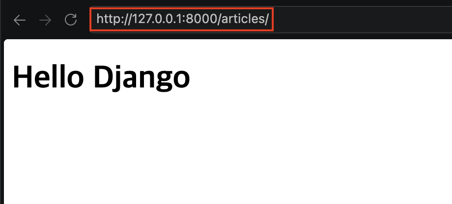

---

_HttpResponse 객체 사용_

서버 실행 후 http://127.0.0.1:8000/nonetemplate/ URL 경로로 요청 전달


---

**HTML 템플릿 vs HttpResponse 객체 차이**

Django에서는 클라이언에게 응답을 반환할 때 `HttpResponse()` 와 `render()` 를 사용할 수 있음

1. **HttpRespnse()**
- HTTP 응답 객체를 직접 생성하는 클래스
- 응답할 내용을 직접 작성하여 반환
- HTML 템플릿을 자동으로 사용하지 않음

```python
from django.http import HttpResponse

def index(request):
  return HttpResponse("<h1>Hello Django!</h1>")
```

2. **render()**
- HTML 템플릿을 렌더링하여 HTML 응답을 생성하는 함수
- 별도의 HTML 템플릿 파일을 사용
- `context` 를 통해 HTML 템플릿에 데이터 전달 가능
- 최종적으로 `HttpRespnse` 객체 반환

```python
from django.shortcuts import render

def index(request):
  return render(request, "articles/index.html")
```

**요약**

|구분|`HttpRespnse()`|`render()`|
|:---:|---|---|
|종류|클래스|함수|
|응답 생성|응답 내용 직접 생성|HTML 템플릿 렌더링|
|HTML 템플릿|자동 사용 X|사용 O|
|반환객체|HttpRespnse|HttpResonse|

## 5. WSGI와 ASGI

Django 프로젝트 디렉터리 하위에 `wsgi.py` 와 `asgi.py` 는 각각 WSGI 서버와 Django 연결, ASGI 서버와 Django 연결

WSGI, ASGI는 클라이언트의 HTTP 요청을 받아 Django 애플리케이션에 전달하고, Django가 처리한 응답을 클라이언트에 전달하는 역할을 수행

**두 방식의 가장 큰 차이는 동기(Synchronous) 방식과 비동기(Asynchronous) 방식의 지원 여부**

**WSGI (Web Server Gateway Interface)**

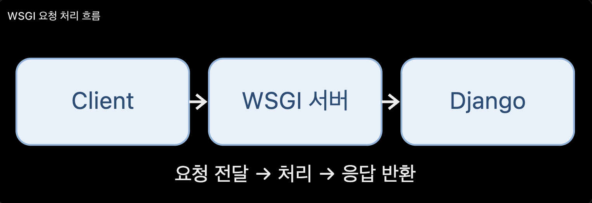

Python 웹 서버와 웹 애플리케이션을 연결하기 위한 표준 인터페이스

주로 동기 방식의 요청 처리를 위해 설계

- **동기 방식 중심** : 일반적으로 요청을 처리하는 동안 해당 실행 흐름은 작업이 끝날 때까지 기다림
- **HTTP 요청 처리** : 일반적인 웹 페이지 조회, 게시글 CRUD 등의 기능에 적합
- **대표적인 서버** : Gunicorn, uWSGI

1. 클라이언트가 게시글 목록을 요청
2. WSGI 서버가 Django에 요청을 전달
3. Django의 View 함수가 요청을 처리
4. 처리된 결과를 WSGI 서버를 통해 클라이언트에 반환

---

**ASGI (Asynchronous Server Gateway Interface)**

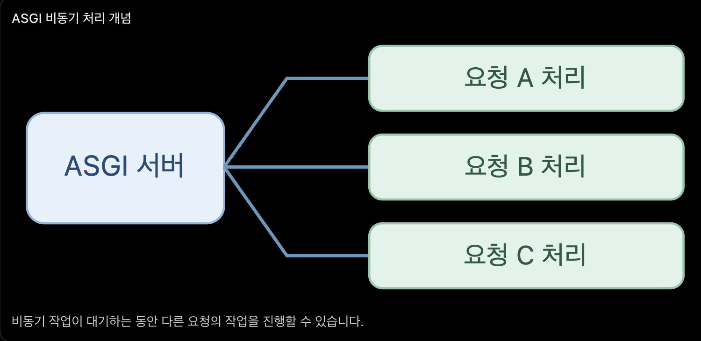

WSGI의 한계를 보완하여 비동기 처리와 장시간 유지되는 연결을 지원하도록 설계된 인터페이스

- **동기 및 비동기 지원** : 동기 코드와 비동키 코드를 모두 처리할 수 있음
- **다양한 통신 프로토콜** : HTTP뿐 아니라 WebSocket 등의 연결도 지원
- **대표적인 서버** : Uvicorn, Daphen, Hypercorn

단, ASGI를 사용한다고 모든 Django 코드가 자동으로 비동기가 되는 것이 아님

**WSGI와 ASGI 비교 요약**

|구분|WSGI|ASGI|
|---|---|---|
|명칭|Web Server Gateway Interface|Asynchronous Server Gateway Interface|
|처리 방식|동기 중심|동기 + 비동기|
|HTTP|지원|지원|
|WebSocket|표준에서 미지원|지원
|활동 예시|일반적인 웹 서비스|일반 웹 서비스, 실시간 통신|

---

## 6. 프로젝트 `Settings.py` 추가 정보

> #### 1. 한국어를 기본 언어로 변경하는 방법
> - `settings.py` 파일에서 `LANGUAGE_CODE` 를 수정
> ```python
># 변경 전
>LANGUAGE_CODE = 'en-us'
>
>TIME_ZONE = 'UTC'
>
>USE_I18N = True
>
>USE_TZ = True
> ```
>---
>```python
># 변경 후
>LANGUAGE_CODE = 'ko-kr'
>
>TIME_ZONE = 'Asia/Seoul'
>
>USE_I18N = True
>
>USE_TZ = True
>```
>각 설정의 의미
>
>|설정|설명|
>|---|---|
>|`LANGUAGE_CODE = 'ko-kr'`|Django의 기본 언어를 한국어로 설정|
>|`TIME_ZONE = 'Asia/Seoul'`|기본 시간대를 한국 표준시로 설정|
>|`USE_I18N = True`|Django의 다국어 번역 기능 활성화|
>|`USE_TZ = True`|시간대 정보를 고려한 날짜 및 시간 처리 활성화|
>
> 적용 결과
>
> 설정을 변경하면 Django에서 제공하는 번역 가능한 기본 메시지들이 한국어로 표시됨
>
> 예를 들면 Django 관리자 페이지 (`/admin/`)의 로그인 확인이나 기본 안내 메시지가 한국어로 표시될 수 있다.
>
>단, 개발자가 직접 작성흰 HTML 자동으로 한국어로 번역되는 것은 아님
>
> ---
>
>**핵심 정리** : Django 프로젝트에서 한국어를 기본 언어로 사용하려면
>
> `settings.py` 의 `LANGUAGE_CODE = 'ko-kr'` 로 변경하면 됨.
>
> 한국 시간대까지 적용하려면 `TIME_ZONE = 'Asia/Seoul'` 도 함께 설정하면 됨

---

<br>

## 7. Template System

#### 1. Template System이란?

Template System은 Django에서 **HTML 문서에 동적인 데이터를 결합하여 최종 HTML 생성하는 시스템**

일반적인 HTML은 작성된 내용이 그대로 표시되지만, **Django의 Template System을 사용하면 서버에서 전달한 데이터에 따라 HTML의 내용을 동적으로 변경할 수 있음**

#### 2. Template System의 동작 과정


1. 클라이언트가 서버에 페이지를 요청한다
2. Django의 View 함수가 필요한 데이터를 준비한다.
3. View 함수가 HTML 템플릿과 데이터를 Template System에 전달한다.
4. Template System이 데이터를 HTML에 반영한다.
5. 완성된 HTML이 클라이언트에 응답으로 전달된다.

#### 3. Template System 사용 예시

```python
# 1. views.py - 데이터 전달

from django.shortcuts import render

def index(request):
    context = {
      "username": "땅타",
      "age": 25,
    }
    return render(request, "articles/index.html", context)
```
- `context` 는 HTML 템플릿에 전달할 데이터를 담는 딕셔너리

<br>

```html
<!-- 2. index.html - 데이터 출력 -->

 <h1>사용자 정보</h1>
 <p>이름: {{ username }}</p>
 <p>나이 : {{ age }}</p>
```
- `{{ username }}` 과 `{{ age }}`는 Django Template Language(DTL) 의 변수 표현 식

<br>


### Template System의 주요 기능

- **동적 데이터 출력** : View에서 전달한 데이터를 HTML에 표시
- **조건문과 반복문** : 데이터에 따라 HTML 요소를 선택하거나 반복 출력
- **템플릿 상속** : 공통 HTML 구조를 재사용
- **URL 태그** : URL 이름을 이용해 경로를 동적으로 생성
- **필터** : 전달받은 데이터를 출력 목적에 맞게 가공

<br>

## 8. Django Template Language (DTL)

DTL(Django Template Language) 은 DJango 템픞릿에서 동적인 데이터를 표현하기 위해 사용하는 템플릿 언어

|구분|문법|역할|
|:---:|:---:|:---:|
|Variable|`{{ variable }}`|데이터 출력|
|Tag|``|반복, 조건, 상속 등|
|Filter|`{{ value\|filter }}`|데이터 가공|
|Comment|`{# comment #}`|템플릿 주석|

### DTL 사용 예시


<br>

## 9. 템플릿 상속

템플릿 상속(Template Inheritance)은 Django에서 여러 HTML 페이지에 **공통으로 사용되는 구조를 하나의 부모 템플릿에 정의**하고, **자식 템플릿이 이를 상속받아 재사용**하는 기능

예를 들어 **웹사이트에는 여러 페이지가 존재**하지만, **페이지마다 공통으로 사용되는 부분이 존재**

- Header (상단 메뉴)
- Navigation (네비게이션)
- Footer (하단 정보)

이러한 공통 구조를 매번 작성하지 않고, **부모 템플릿에 한 번 정의하여 여러 자식 템플릿에서 재사용하는 것이 템플릿 상속의 목적**

### 템플릿 상속 구조


부모 템플릿인 `base.html` 은 전체 HTML 구조를 정의하고, 자식 템플릿인 `index.html`, `detail.html` 은 각 페이지에 필요한 내용만 작성하는 방식

### 템플릿 상속 구현 방법

1. 부모 템플릿 작성 > base.html

```html
</head>
<body>
  <header>
    <h1>My Website</h1>
  </header>

  
  

  <footer>
    <p>Copyright 2026</p>
  </footer>
</body>
</html>
```

>
>
>
> 
> 해당 부분이 핵심 코드 `block` 태그는 **자식 템플릿에서 내용을 재정의 할 수 있는 영역**을 지정하는 역할

2. 자식 템플릿 작성 > index.html

```html



  <h2>메인 페이지</h2>
  <p>환영합니다</p>

```

>|사용 DTL 태그|역할|
>|---|---|
>|``|부모 템플릿을 상속|
>|``|부모 템플릿의 content 영역을 재정의|
>|``|블록 영역의 끝을 표시

3. 최종 렌더링 결과


### 템플릿 상속 시 주의점

**`extends` 태그는 템플릿의 첫 번째 템플릿 태그여야 함**
- `extends` 보다 앞에 다른 템플릿 태그를 작성하면 오류가 발생할 수 있음. 따라서 파일의 가장 위에 작성하는 것을 권장

**부모와 자식의 block 이름을 일치시킴**

```html
<!-- 부모 -->
 
 

<!-- 자식 -->
 
  <h1>Hello</h1>
 
```

**하나의 템플릿에서 여러 개의 block을 정의할 수 있음**

```html
{% block title %




```

**부모 block의 내용을 유지하면서 추가할 수 있음**

```html
<!-- 부모 템플릿: base.html-->

  <h1>부모 템플릿 내용</h1>


<!-- 자식 템플릿: index.html-->



  {{ block.super }}
  <p>자식 템플릿 내용</p>

```

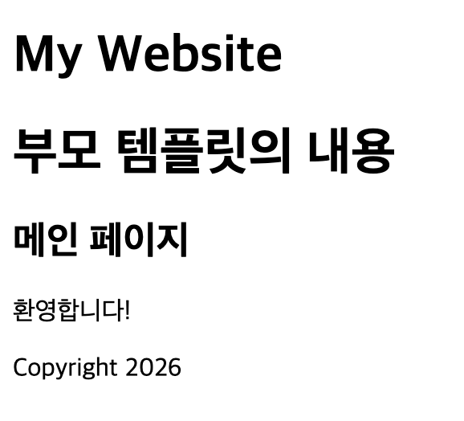


- 부모 템플릿의 block 태그에 작성되어 있는 데이터를 자식 템플릿에서 사용


### 핵심 정리

Template Inheritance(템플릿 상속)

**여러 HTML 페이지에서 공통으로 사용되는 구조를 부모 템플릿에 정의**하고, **자식 템플릿에서 이를 상속받아 재사용**하는 기능.

부모 템플릿은 공통 HTML 구조를 담당하고, 자식 템플릿은 페이지마다 달라지는 내용을 담당


- `extends` : 부모 템플릿 지정
- `block` : 자식 템플릿에서 재정의할 영역 지정
- `endblock` : 블록 종료
- `block.super` : 부모 블록 내용을 유지하면서 추가 작성

<br>

## 10. HTML form

HTML Form은 **사용자로부터 데이터를 입력받아 서버로 전송**하기 위해 사용하는 HTML 요소

Django에서는 사용자가 입력한 데이터를 서버로 전달하고, **View 함수에서 해당 데이터를 처리**할 때 자주 사용

### HTML Form의 기본 구조

```html
<form action="/catch/" method="GET">
  <label for="message">메시지 입력</label>
  <input text="text" name="message" id="message">
  <button type="submit">전송</button>
</form>
```


### Form 핵심 속성 + input 요소

#### 1. `action`

사용자가 입력한 데이터를 어느 URL로 전송할지 지정하는 속성

Django 데이터를 전송하는 URL과 연결된 View 함수가 데이털르 처리하게 됨

action을 지정하지 않으면 데이터는 현재 페이지의 URL로 설정됨

#### 2. `method`

입력한 데이터를 어떤 HTTP 요청 방식으로 전송할지 지정하는 속성

HTML Form에서 대표적을 사용하는 방식은 `GET` 과 `POST`

|구분|GET|POST|
|---|---|---|
|목적|데이터 조회|데이터 생성 및 변경|
|데이터 전달|URL 쿼리 문자열|HTTP 요청 본문(Body)|
|URL에 데이터 노출|O|X|
|Django 접근|`request.GET`|`request.POST`|

POST도 데이터가 자동으로 암호화되는 것은 아님. 안전한 전송을 위해 HTTPS를 사용해야 함

#### 3. `<input>`

사용자의 데이터를 입력 받을 수 있는 HTML 요소

type 속성 값에 따라 다양한 유형의 입력 데이터를 받음


#### 4. name

서버에 전달되는 데이터의 이름(Key)을 지정하는 속성

`name = '사용자 입력'` 형태로 서버에 전달 되어 Django에서 name 이라는 Key로 값을 사용가능

`name` 속성이 있어야 해당 입력값이 일반적으로 서버에 전송됨

```html
<!-- 예시 -->
 <input type="text" name="message">
```

```python
# Django의 View 함수

message = request.GET.get("message")
```

### HTML Form 데이터 전송 과정


```html
<form action="/catch" method="GET">
  <input type="text" name="message">
  <button type="submit">전송</button>
</form>
```

```python
from django.http import HttpResponse

def catch(request):
  message = request.GET.get("message")

  return HttpResponse(message)
```

1. 사용자가 HTML Form에 데이터를 입력
2. 전송 버튼을 클릭하면 브라우저가 HTTP 요청을 생성
3. Django가 URL에 연결된 View 함수를 실행
4. View 함수에서 request.GET.get("message")로 입력값을 가져옴
5. View 함수가 HTTP 응답을 반환

### Query String Parameters

Query String Parameters(퀴리 문자열 매개변수)는 클라이언트가 서버에 데이터를 전달할 때, **URL 주소의 끝에 추가하는 `Key=Value` 형태의 데이터**

주로 HTTP GET 요청에서 검색어, 필터, 정렬 조건 등의 데이터를 서버에 전달할 때 사용

`http://127.0.0.1:8000/search/?keyword=python&page=2`

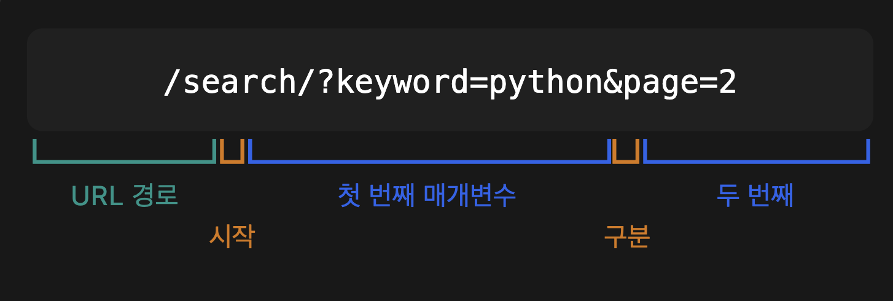

|기호|의미|
|---|---|
|`?`|Query String의 시작|
|`=`|Key와 Value 구분|
|`&`|여러 매개변수 구분|

해당 URL은 서버에 아래의 데이터를 전달하는 것
- keyword = python
- page = 2

### HTML Form과 Query String 관계

HTML Form에서 `method="GET"` 을 사용하면 브라우저가 **입력 데이터를 Query String 형태로 URL에 추가**

```html
<form action="/search/" method="GET">
    <input type="text" name="keyword">
    <button type="submit">검색</button>
</form>
```

사용자가 `django` 라는 데이터를 입력하고 검색 버튼을 누르면 URL 패턴이 `/search/?keyword=django` 로 매핑 됨

핵심은 `input` 태그의 `name` 속성이 **Query String 의 Key가 되고, 사용자가 입력한 데이터가 Value가 됨**

### Query String Parameters 특징

- URL에 데이터가 포함되므로 브라우저 주소창에서 확인할 수 있다
- 검색, 필터링, 페이지네이션 등에 자주 사용됨   
- URL을 복사하여 동일한 검색 조건을 공유할 수 있음
- URL에 데이터가 노출되므로 비밀번호와 같은 민감한 정보는 전달하지 않아야 함
- Query String은 GET 요청에서 주로 사용하지만, GET 요청에서만 제한되는 것은 아님

<br>

## 11. HTTP request 객체

Django에서 **HTTP request 객체**는 클라이언트(브라우저)가 **서버에 보낸 HTTP 요청에 대한 정보를 담고 있는 객체**

### HTTP request 객체란

HTTP request 객체(`HttpReqeust`)는 클라이언트가 보낸 **HTTP 요청 정보를 Django가 Python 객체로 표현한 것**

Django는 요청을 받으면 해당 요청 정보를 담은 `HttpRequest` 객체를 만들고, **이를 View 함수의 첫 번째 인자로 전달**

```python
def search(request):
    ...
```

여기서 `request`가 바로 HTTP request 객체

### HTTP request 객체의 주요 속성

|속성|설명|
|---|---|
|`request.method`|HTTP 요청 메서드(GET, POST 등)|
|`request.GET`|URL의 Query String 데이터|
|`request.POST`|POST 방식으로 전송된 폼 데이터|
|`request.path`|요청한 URL의 경로|
|`requesdt.FILES`|업로드된 파일 데이터|
|`request.headers`|HTTP 요청 헤더 정보|
|`request.body`|HTTP 요청 본문의 원본 바이트 데이터|

### HTTP request 객체 사용 예시

사용자가 HTML Form에 검색어를 입력하고 제출하는 상황

```html
<!--HTML Form 작성-->
<form action="/search/" method="GET">
  <input type="text" name="keyword">
  <button type="submit">검색</button>
</form>
```

사용자가 'Python' 입력하고 검색 버튼을 클릭 시 생성 요청


`GET /search/?keyword=Python`

```python
# Django View 함수에서 요청 데이터 확인
def search(request):
  keyword = request.GET.get("keyword")

  print(request.method) # GET
  print(request.path) # /search/
  print(keyword) # Python

  return HttpResponse(keyword)
```
- `request` : HTTP 요청 정보를 담은 객체
- `.GET` : Query String 데이터를 담은 `QueryDict` 객체
- `.get("keyword")` : `keyword` 라는 이름에 해당하는 값을 가져오는 메서드

#### request.GET과 request.POST의 차이

|구분|request.GET|request.POST|
|---|---|---|
|데이터 위치|URL의 Query String|HTTP 요청 본문의 폼 데이터|
|대표적인 사용|검색, 필터링|회원가입, 로그인 폼|
|데이터 접근|`request.GET.get()`|`request.POST.get()`|

#### 핵심 요약

HTTP request 객체 (`HttpRequest`)
- 클라이언트가 서버에 보낸 HTTP 요청 정보를 담는 Python 객체
- Django가 HTTP 요청을 받아 생성하고 View 함수에 전달
- View 함수에서는 `request` 인자를 통해 요청 정보에 접근
- 요청 메서드, URL 경로, Query String, 폼 데이터, 헤더 등의 정보를 확인할 수 있음

```python
# 핵심 코드
def index(request):
  request.method # HTTP 요청 메서드
  request.GET.get("key") # Query String 데이터
  request.POST.get("key") # POST 폼 데이터
  request.path # 요청 URL 경로
```
**HTTP request 객체는 Django의 View 함수가 클라이언트의 요청을 이해하고 처리할 수 있도록 요청 정보를 전달하는 객체**

<br>

## 12. Django URLs

Django에서 URLs는 클라이언트가 요청한 URL 주소를 분석하여, 해당 요청을 처리할 View 함수와 연결하는 역할

즉, **사용자가 특정 URL에 접근했을 실행할 View 함수를 결정하는 기능**

### Djaogn URLs란?

Django는 클라이언트가 HTTP 요청을 보내면 URL을 확인하고, 해당 URL에 연결된 View 함수 실행

URL을 확인하여 적절한 View 함수에 연결하는 과정을 **URL Routing(라우팅)**
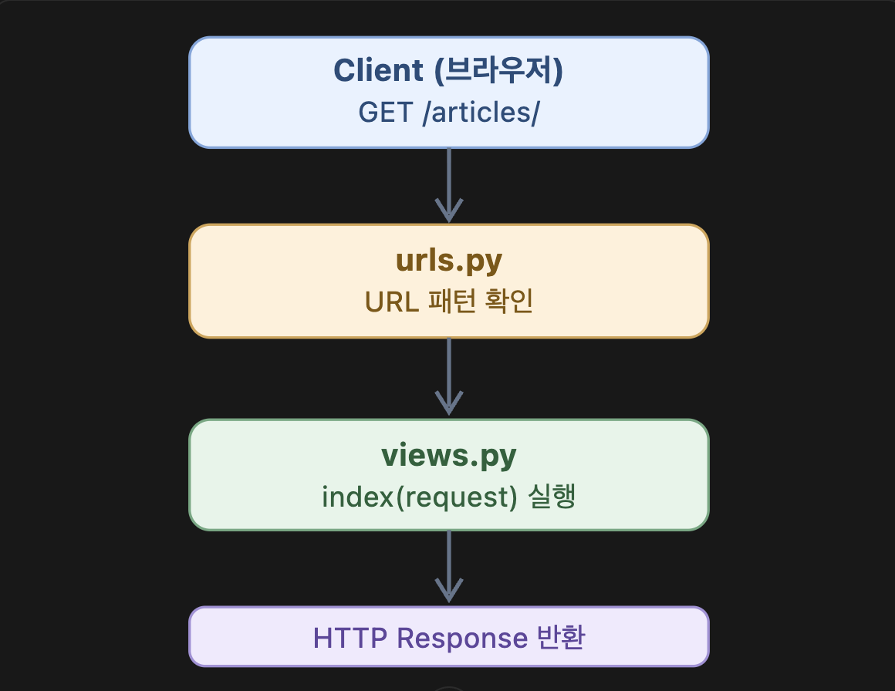

### urls.py 역할

Django 프로젝트를 생성하면 기본적으로 프로젝트 디렉터리에 `urls.py` 파일이 만들어짐

`urls.py` 에서는 `urlpatterns` 라는 리스트를 사용해 URL 패턴을 정의

```python
# project 디렉터리의 urls.py

from django.contrib import admin
from django.urls import path
from articles import views # App의 View 함수 모듈

urlpatterns = [
  path('admin/', admin.site.urls),
  path('articles/', views.index),
  path('articles/new/', views.new),
]
```

`path()` 는 특정 URL 경로와 View 함수를 연결하는 함수

`path(route, view, kwargs=None, name=None)`

|인자|역할|
|---|---|
|`route`|요청 URL과 비교할 경로 패턴|
|`view`|URL이 일치하면 실행할 View 함수|
|`kwargs`|View 함수에 전달할 추가 키워드 인자|
|`name`|URL 패턴에 부여할 이름|

```python
path('articles/', views.index, name='index')
```
- `'articles/'` : 요청 URL의 경로 패턴
- `views.index` : 요청을 처리할 View 함수
- `name='index'` : URL 패턴의 이름

Django는 `urlpatterns` 를 위에서부터 순서대로 검사하며, 요청 경로와 일치하는 첫 번째 패턴을 사용

일치하는 URL 패턴이 없다면 일반적으로 `404 Not Found` 응답을 반환

### Variable Routing

Django URLs에서는 **URL의 일부를 변수로 받아 View 함수에 전달**할 수 있음

이를 **Variable Routing(변수 라우팅)** 이라고 함

```python
# urls.py

urlpatterns = [
  path('articles/<int:pk>/', views.detail, name='detail')
]
```

`<int:pk>` 는 URL의 일부를 정수로 받아 `pk` 라는 이름의 인자로 전달한다는 의미

```python
# views.py

def detail(request):
    return HttpResponse(f"{pk}번 게시글")
```

게시글마다 별도의 URL 패턴을 작성할 필요 없이 **하나의 패턴으로 여러 게시글을 처리할 수 있음**

### Django URL Dispatcher란?

|구분|설명|
|---|---|
|Django URLs|URL 패턴을 정의하고 관리하는 기능 및 설정|
|URL Dispatcher|요청 URL의 패턴과 비교하여 적절한 View 함수를 찾아 연결하는 메커니즘|

### 핵심 정리

**Django URLs**
- 클라이언트가 요청한 URL을 적절한 View 함수에 연결하는 기능
- `urls.py`에서 `urlpatterns` 리스트를 사용하여 URL 패턴 정의
- `path()` 함수를 사용해 URL 경로와 View 함수 연결
- URL Dispatcher가 요청 URL과 URL 패턴을 비교하여 View 함수 결정
- Variable Routing을 사용하면 URL의 일부를 변수로 전달할 수 있음
- 일치하는 URL 패턴이 없다면 일반적으로 404 오류 발생


<br>

## 13. App URL 

Django에서 App URL 정의란 **각 앱(App)이 담당하는 URL 경로를 해당 앱의 `urls.py` 에서 직접 관리하도록 분리**하는 것

Django 프로젝트에는 여러 앱이 존재할 수 있음.

각 앱의 URL을 프로젝트의 `urls.py` 에서 모두 관리하면 URL이 많아질수록 코드가 복잡해짐

따라서 Django에서는 **프로젝트 URL과 앱 URL을 분리하여 관리하는 방식 사용**

### 프로젝트 URL과 앱 URL의 관계


- **프로젝트 `urls.py`** : 요청된 URL을 어떤 앱에서 처리할지 결정
- **앱 `urls.py`** : 전달받은 URL을 어떤 View 함수에서 처리할지 결정

### App URL 정의 방법

>#### 1. 앱 내부에 `urls.py` 생성
>Django는 앱을 생성할 때 `urls.py`를 자동으로 생성하지 않으므로 직접 만들어야 함

>#### 2. 앱 `urls.py` 작성
>```python
>from django.urls import path
>from . import views
>
> urlpatterns = [
>   path('', views.index, name='index'),
>   path('<int:pk>/', views.detail, name='detail'), 
>]
>```

>#### 3. 프로젝트 `urls.py` 에서 `include()` 함수 사용
>```python
>from django.contrib import admin
>from django.urls import path, include
>
> urlpatterns = [
>   path('admin/', admin.urls),
>   path('articles/', include('articles.urls')),  
>]
>```
> - `articles/` : 해당 경로로 시작하는 요청 처리
> - `include()` : 다른 URL 설정 파일을 연결
> - `"articles.urls"` : `articles` 앱의 `urls.py` 의미
>
> 즉, `/articles/` 로 시작하는 요청은 `articles/urls.py` 에서 이어서 처리하게 됨

### App URL 정의의 장점

1. **유지보수 용이** : 각 앱의 URL을 독립적으로 관리 가능
2. **가독성 향상** : 프로젝트의 `urls.py`가 복잡해지는 것을 방지
3. **재사용성 향상** : 앱의 URL 설정을 다른 프로젝트에서도 재사용하기 쉬워짐
4. **역할 분리** : 프로젝트는 앱 연결을, 앱은 세부 URL 매핑을 담당

<br>


<br>

## 14. URL 이름 지정 (Naming URL Patterns)

### URL 이름 지정?

Django에서 URL 이름 지정이란 `urls.py`에 정의한 **URL 패턴에 고유한 이름을 부여**하는 기능

URL 경로를 직접 작성하는 대신, **지정한 이름을 사용해 해당 URL을 참조**할 수 있도록 해줌

```python
# articles/urls.py

from django.urls import path
from . import views

urlpatterns = [
  path('index/', views.index, name='index'),
  path('create/', views.create, name='create'),
]
```
- `name='index'` 와 `name='create'` 가 URL에 이름을 지정하는 부분

|구분|의미|
|---|---|
|`index/`|실제 URL 경로|
|`views.index`|요청을 처리할 View 함수|
|`name='index'`|URL 패턴에 부여한 이름|

### URL 이름을 지정하는 이유

**URL 경로가 변경되더라도 해당 URL을 사용하는 코드를 일일히 수정하지 않기 위함**

>#### URL 이름을 사용하지 않는 경우
>`<a href='/articles/index/'>게시글 목록</a>`
>
>URL이 `/articles/index/` 에서 `/articles/list/` 로 변경되면 HTML 코드도 직접 수정해야 함

>#### URL 이름을 사용하는 경우
>`<a href="">게시글 목록</a>`
>
>Django의 DTL(Django Template Language)에서 `url` 태그를 사용하면 URL 이름을 통해 실제 경로를 찾아줌
>
>따라서 URL 경로가 변경되더라도 `name='index'`를 한다면 HTML 코드를 수정할 필요가 없음

### URL 이름을 통한 동작 과정


- `` 는 URL 이름을 이용해 실제 경로를 생성하는 역할을 수행

### Variable Routing과 URL 이름 지정

```python
# articles/urls.py

urlpatterns = [
  path('', views.index, name='index'),
  path('<int:pk>', views.detail, name='detail'),
]
```
- `detail` URL은 `pk` 라는 정수 값이 필요 함

```html
<a href = "">
  게시글 상세보기
</a>
```
- 만약 `article.pk`가 `3` 이라면<br>
`<a href='/articles/3/'>게시글 상세보기</a>` 같은 HTML이 생성 됨
- `name='detail'` 은 URL의 이름이고, `article.pk` 는 URL을 생성하기 위해 전달하는 값

### 핵심 정리
**URL 이름 지정(Naming URL Patterns)**
- `path()` 의 `name` 인자를 사용하여 URL 패턴에 이름을 부여하는 기능
- URL 경로를 직접 작성하지 않고 이름으로 참조할 수 있음
- URL 경로가 변경되더라도 이름이 유지되면 관련 코드를 수정할 필요가 줄어듦
- HTML 템플릿에서는 `` 형식으로 사용
- 서로 다른 앱의 URL 이름이 충돌하는 문제는 URL 이름 공간을 통해 해결 가능

**URL 이름 지정은 URL 경로와 해당 URL을 참조하는 코드 사이의 의존성을 줄여 유지보수를 쉽게 만들어 주는 기능**

<br>

## 15. App URL 정의

프로젝트에서 관리하던 URL 패턴을 **각 앱(App)의 `urls.py` 파일로 분리하여 관리**하는 방법

Django에서는 기본적으로 프로젝트를 생성하면 프로젝트 폴더에 `urls.py` 가 만들어지지만, 앱을 생성할 때는 `urls.py`가 자동으로 만들어지지 않음

따라서 **앱별로 URL을 관리하려면 직접 `urls.py` 파일을 생성해야 함**

### App URL을 분리하는 이유

하나의 웹 서비스에 게시글, 회원, 상품 기능이 있는 상황에서 

모든 URL을 프로젝트의 `urls.py`에서 관리한다면

```python
# 프로젝트 urls.py

urlpatterns = [
  path('articles/', views.article_index),
  path('articles/create/', views.article_create),
  path('accounts/login/', views.login),
  path('accounts/logout/', views.logout),
  path('products/', views.product_index),
]
```
- 기능이 많아질수록 URL 패턴도 늘어나고 관리가 어려워짐

### App URL 분리 구조


### App URL 정의 방법

`articles` 앱이 있다고 가정

#### 1. articles 앱에 `urls.py` 생성

#### 2. App의 `urls.py` 작성

```python
# articles/urls.py

from django.urls import path
from . import views

urlpatterns = [
  path('', views.index, name='index'),
  path('create/', views.create, name='create'),
  path('<int:pk>/', views.detail, name='detail'),
]
```
- `articles/` 라는 경로를 따로 작성하지 않음
- 프로젝트의 `urls.py` 에서 공통 경로를 처리

#### 3. 프로젝트 urls.py에서 `include()` 사용

```python
# 프로젝트 urls.py

from django.contrib import admin
from django.urls import path, include

urlpatterns = [
  path('admin/', admin.site.urls),
  path('articles/', include('articles.urls')),
]
```
- `include()`는 다른 URL 설정 파일을 연결하는 함수
- `path('articles/', include('articles.urls'))` 는 `/articles/` 로 시작하는 요청 `articles/urls.py` 에서 이어서 처리하도록 연결

### URL 요청 처리 과정


- Django는 프로젝트 URL과 앱 URL을 연결하여 최종적으로 실행할 View 함수를 찾음

### 최종 URL은 어떻게 결정되나

프로젝트 `urls.py` 에서 `articles/` 를 지정했다고 가정하면 다음과 같음

|프로젝트 URL|App URL|최종 URL|
|---|---|---|
|`articles/`|`''`|`/articles/`|
|`articles/`|`create/`|`/articles/create/`|
|`articles/`|`<int:pk>/`|`/articles/3/` (pk=3)|

- `''` 는 빈문자열이므로 프로젝트에서 지정한 `/articles/` 경로 자체에 대응

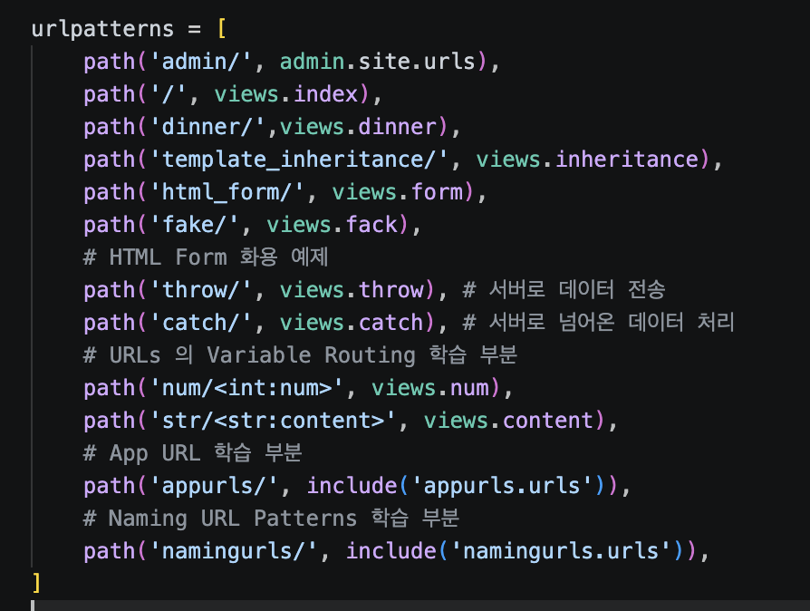

- 프로젝트 `urls.py` 에서 `/namingurls/` 접근 요청은 **namingurls** 앱의 `urls.py` 에서 View 함수를 호출하도록 지정

<br>


<br>


### 핵심 정리

- **App URL 정의** : 앱별로 URL 패턴을 분리하여 관리하는 방법
- **프로젝트 urls.py** : 요청 URL의 공통 경로를 확이낳고 담당 앱의 URL 설정으로 연결
- **앱 urls.py** : 전달받은 나머지 URL 경로를 확인하고 View 함수에 연결
- **include()** : 다른 URL 설정 파일을 포함하여 URL 처리를 위임하는 함수
- **장점** : 기능별 URL 관리가 쉬워지고 프로젝트의 유지보수성과 재사용성이 좋아짐

**Django의 App URL 정의는 프로젝트 `urls.py`에서 `include()` 를 사용하여 각 앱의 `urls.py`로 URL 처리를 분리하는 방식**

<br>

## 16. Naming URL Patterns (URL 이름 지정)

Naming URL Patterns 란 Django에서 **URL 패턴에 고유한 이름을 지정**하여 URL **경로**를 직접 작성하지 않고 **이름으로 참조할 수 있도록 하는 기능**

Django에서는 `path()` 함수의 `name` 인자를 사용하여 URL 패턴에 이름을 지정할 수 있음

```python
# articles/urls.py

from django.urls import path
from . import views

urlpatterns = [
  path('index/', views.index, name='index'),
  path('create/', views.create, name='create'),
]
```
- `name='index'` 와 `name='create'` 가 URL 패턴에 지정한 이름
- `index/` : 실제 URL 경로
- `views.index` : 요청을 처리할 View 함수
- `name='index'` : URL 패턴을 참조하기 위한 이름

### URL에 이름을 지정하는 이유

URL에 이름을 지정하는 가장 큰 이유는 **URL 경로가 변경되더라도 해당 URL을 참조하는 코드를 일일이 수정하지 않기 위함**

#### 1. URL 이름을 사용하지 않는 경우

```html
<a href='/articles/create/'>게시글 수정</a>
```
- URL 경로가 `/articles/new/` 로 변경된다면 -> 기존 경로를 직접 작성한 HTML 파일 수정

#### 2. URL 이름을 사용하는 경우

```python
# articles/urls.py

urlpatterns = [
  path('/new/', views.create, name='create'), 
]
```
```html
<a href="">게시글 작성</a>
```
- 실제 경로기 변경되더라도 `name='create'`는 그대로이므로 HTML 파일을 수정할 필요가 없음

단, 프로젝트에서 `articles/` 경로로 앱 URL을 연결했고, URL 이름에 네임스페이스를 적용하지 않았다고 가정한 예시

### DTL의 url 태그와 관계

Django Template Language(DTL)에서는 `{$ url %}` 태그를 사용하여 URL 패턴의 이름으로 실제 URL을 생성할 수 있음

```python
# articles/urls.py

urlpatterns = [
  path('index/', views.index, name='index'),
  path('create/', views.create, name='create'),
]
```
```html
<a href="">게시글 목록</a>
<a href="">게시글 작성</a>
```


- 즉, `` 태그는 **URL 이름을 기반으로 실제 URL 경로를 생성**하는 역할 수행

### Variable Routing과 함께 사용하기

```python
# articles/urls.py

urlpatterns = [
  path('<int:pk>/', views.detail, name='detail'),
]
```
```html
<a href="">
  게시글 상세보기
</a>
```


- 프로젝트 `urls.py` 파일에 공통 경로를 추가

<br>


- URL 패턴 생성 시 `name` 속성을 통해 URL 패턴 자체에 이름 지정

<br>


<br>


### 핵심 정리

|구분|설명|
|---|---|
|Naming URL Patterns|URL 패턴에 이름을 지정하는 기능|
|`name`|URL 패턴의 이름을 지정하는 인자|
|``|DTL에서 URL 이름으로 실제 경로 생성|

**Naming URL Patterns 는 URL 패턴에 이름을 지정하여 실제 URL 경로 대신 이름으로 참조할 수 있도록 하는 Django의 기능**

**핵심은 URL 경로와 URL을 참조하는 코드를 분리하여 유지보수성을 높이는 것**

<br>

## 17. URL 이름 공간

**URL Namespace**란 **서로 다른 Django 앱**에서 **동일한 URL 이름**을 사용하더라도 충돌하지 않도록 **구분하는 기능**

Naming URL Patterns에서는 `name`을 사용하여 URL 패턴에 이름을 지정

이때 서로 다른 앱에서 같은 URL 이름을 사용하는 경우 어떤 앱의 Naming URL Patterns 이름을 참조해야 하는지 명확하지 않기 때문에 충돌 발생

이를 방지하기 위한 방법 = **URL Namespace**

### URL Namespace 설정 방법

**Django에서는 앱의 `urls.py`에 `app_name` 변수를 선언하여 애플리케이션 이름 공간을 지정 가능**

#### 1. `articles/urls.py`

```python
from django.urls import path
from . import views

app_name = 'articles'

urlpatterns = [
  path('index/', views.index, name='index'),
  path('create/', views.create, name='create'),
]
```

#### 2. `accounts/urls.py`

```python
from django.urls import path
from . import views

app_name = 'accounts'

urlpatterns = [
  path('index/', views.index, name='index'),
  path('login/', views.login, name='login'),
]
```

#### 3. 프로젝트 `urls.py`

```python
from django.urls import path, include

urlpatterns = [
  path('articles/', include('articles.urls')),
  path('accounts/', include('accounts.urls')),
]
```

- 두 앱에서 동일한 `index` 라는 URL 패턴 이름을 사용하더라도 구분 가능

### URL Namespace 사용 방법

URL 이름 공간을 지정했다면 DTL의 `` 태그에서 `` 방법으로 사용

```html
<!-- articles 앱의 index -->
<a href="">
  게시글 목록
</a>

<!-- accounts 앱의 index-->
 <a href="">
  회원 페이지
</a>
```


### URL Namespace와 Naming URL Patterns의 차이

|구분|Naming URL Patterns|URL Namespace|
|---|---|---|
|목적|URL 패턴에 이름 지정|URL 이름 충돌 방지|
|설정|`name='index'`|`app_name='articles'`|
|참조|``|``|
|특징|이름으로 URL 참조|앱별로 같은 이름 사용 가능|

<br>

## 18. 추가 템플릿 경로 (Additional Template Paths)

Django에서 기본적으로 탐색하는 템플릿 경로 외에 **개발자가 직접 템플릿 탐색 경로를 추가**하는 것

Django는 HTML 템플릿을 찾을 때 `settings.py`의 `TEMPLATES` 설정을 참고

일반적으로 템플릿을 관리하는 방법

1. **앱별 템플릿** : 각 앱의 `templates/` 디렉터리에서 관리

2. **프로젝트 공통 템플릿** : 프로젝트 수준의 `templates/` 디렉터리에서 관리

추가 템플릿 경로는 주로 여러 앱에서 공통으로 사용하는 HTML 파일을 관리할 때 활용


|설정|역할|
|---|---|
|`DIRS`|개발작 직접 추가하는 템플릿 탐색 경로|
|`APP_DIRS`|설치된 Django 앱 내부의 `templates/` 디렉터리를 탐색할지 결정|

<br>

```python
"DIRS" : [BASE_DIR / 'templates']
```
- `BASE_DIR` : 일반적으로 `manage.py` 가 위치한 프로젝트 최상위 디렉터리
- `/"templates"` 는 해당 디렉터리 아래의 `templates` 폴더 의미
- 따라서 Django가 프로젝트 최상위의 `templates/` 도 탐색

<br>
<hr>
<br>

```python
"APP_DIRS": True
```
- `True` 로 설정하면 `INSTALLED_APPS` 에 등록된 앱들의 `templates/` 디렉터리도 탐색
- 일반적으로 Django 프로젝트를 생성하면 `True`로 설정되어 있음

### Django의 템플릿 탐색 순서


### 핵심 정리

Django가 HTML 템플릿을 탐색할 수 있도록 `settings.py` 의 `TEMPLATES['DIRS']`에 새로운 디렉터리 경로를 등록하는 것

```python
"DIRS": [BASE_DIR / 'templates'],
"APP_DIRS" : True,
```

- `DIRS` : 프로젝트 수준의 템플릿 탐색 경로를 추가
- `APP_DIRS` : Django 앱 내부의 `templates/` 디렉터리 탐색 확성화
- `BASE_DIR` : 일반적으로 `manage.py` 가 있는 최상위 디렉터리
- `활용 목적` : 여러 앱에서 사용하는 공통 템플릿(`base.html` 등)을 한곳에서 관리 

<br>

## 19. DTL 주의사항

DTL(Django Template Language)은 **Django에서 HTML 문서를 동적으로 생성**하기 위한 **템플릿 언어**

### 1. Python 문법과 다르다

DTL은 Python과 비슷한 문법을 일부 사용하지만, **Python 코드를 그대로 작성할 수는 없음**
```html
<!-- 올바른 DTL 문법-->

  <p>{{ article.title }}</p>

```
- Python의 `for` 문과 달리 콜론(`:`)을 사용하지 않는다.
- `len()`, `range()` 같은 함수를 일반 Python 코드처럼 직접 호출할 수 없음

### 2. 변수와 태그를 구분헤야 함

DTL에서는 사용하는 목적에 따라 문법이 다름

|구분|문법|역할|
|---|---|---|
|Variable|`{{}}`|변수의 값을 출력|
|Tag|``|반복문, 조건문, 상속 등 처리|
|Filter|`\|`|변수의 값을 가공|
|Comment|`{# #}`|한 줄 주석|

### 3. 태그는 정확하게 닫아야 함

DTL의 일부 태그는 반드시 종료 태그가 필요
```html

  <p>게시글이 있습니다.</p>



  <p>{{ articles.title }}</p>

```
- 특히 `if`, `for`, `block` 태그는 각각 `endif`, `endfor`, `endblock` 으로 닫아야 함
- 단, ``, `` 처럼 별도의 종료 태그가 필요 없는 태그도 존재

### 4. 템플릿 상속 시 extends 위치 주의
```html


{% block content % }
  <h1>게시글 목록</h1>

```
- `extends` 보다 앞에 다른 템플릿 태그를 작성하면 오류가 발생할 수 있음

### 5. block 태그에는 하나의 이름만 지정

`block` 태그를 선언할 때는 블록 이름을 하나만 작성
```html
<!-- 올바른 문법 -->
 
 

 <!-- 잘못된 문법 -->


```
- Django DTL에서는 하나의 자식 템플릿 안에 동일한 이름의 ``을 여러 번 선언할 수 없음

### 6. DTL은 복잡한 비즈니스 로직을 처리하는 용도가 아님

- DTL은 주로 데이터를 화면에 표현하는 역할을 담당
- 복잡한 데이터 처리나 비즈니스 로직은 Python의 `views.py` 등에서 수행하고, 템플릿에서는 전달받은 데이터를 출력

<br>

## 20. Trailing Slashes (후행 슬래시)

Trailing Slash(후행 슬래시)란 URL 경로의 마지막에 붙는 슬래시(`/`)를 의미

```text
http://127.0.0.1:8000/articles/
http://127.0.0.1:8000/articles
```
두 URL은 비슷해 보이지만 **Django에서는 서로 다른 URL 경로로 취급**

### Django에서 Trailing Slash를 사용하는 이유

Django는 일반적으로 URL 패턴의 마지막에 슬래시(`/`)를 붙이는 방식을 권장
```python
# urls.py

urlpatterns = [
  path('articles/', views.index, name='index')
]
```

### APPEND_SLASH 설정

Django의 `settings.py` 에서 설정 가능
```python
# settings.py

APPEND_SLASH = True
```
기본값은 `True` 이며, `CommonMiddleware`가 활성화되어 있을 때 동장


Django가 기존 요청을 내부적으로 수정하는 것이 아닌, **슬래시가 붙은 URL로 다시 요청하도록 리다이렉트**

단, 슬래시가 없는 URL이 이미 정상적인 URL 패턴과 일치한다면 리다이렉트하지 않음

### APPEND_SLASH 설정에 따른 차이

```python
urlpatterns = [
  path('articles/', views.index, name='index'),
]
```

|요청 URL|`True`|`False`|
|`/articles/`|정상 처리|정상 처리|
|`/articles`|`/articles/` 로 리다리엑트|404 오류|
|`/unknown`|404 오류|404 오류|

### 주의사항

**APPEND_SLASH가 있다고 해서 URL 패턴에서 후행 슬래시를 생략해도 되는 것은 아님**

`APPEND_SLASH`는 개발자가 URL 패턴을 잘못 작성했을 때 자동으로 보완하는 기능이 아닌, **사용자가 후행 슬래시를 생략해 요청한 경우를 처리하기 위한 기능**

특히 `POST`, `PUT`, `PATH` 처럼 데이터를 전송하는 요청에서는 리다이렉트 과정에서 요청 본문이나 메서드가 의도대로 유지되지 않을 수 있음.

Django 개발 환경에서는 `DEBUG=True` 일 때 슬래시 없는 POST 요청에 대해 `RuntimeError`가 발생할 수 있음

따라서 처음부터 정확한 URL을 사용하는 것이 중요

### 핵심 정리

|구분|설명|
|Trailing Slash|URL 마지막에 붙는 `/`|
|Djang URL|후행 슬래시 유무에 따라 서로 다른 경로|
|`APPEND_SLASH=True`|조건을 만족하면 슬래시가 붙은 URL로 리다이렉트|
|`APPEND_SLASH=False`|자동 리다이렉트하지 않음|
|주의사항|URL 패턴 작성 시 후행 슬래시를 일관되게 사용|

**Django의 `APPEND_SLASH`는 후행 슬래시가 없는 요청을 보완하는 기능이지, URL 패턴에서 후행 슬래시를 생략해도 된다는 의미는 아님**

<br>

## 21. Django Model (모델)

**Django Model**은 데이터베이스의 **테이블 구조를 Python 클래스로 정의**하고, **데이터를 관리**할 수 있도록 하는 **Django의 구성 요소**

Django는 Model을 통해 데이터베이스의 데이터를 생성(Create), 조회(Read), 수정(Update), 삭제(Delete)할 수 있음.

해당 작업을 **CRUD**라고 함

쉽게 말하면, **SQL을 직접 작성하지 않고도 Python 코드로 데이터베이스를 다룰 수 있도록 도와주는 역할**

### Django Model과 데이터베이스의 관계


|Django (Python)|데이터베이스 (DB)|
|---|---|
|Model 클래스|테이블(Table)|
|Model 필드|열(Column)|
|Model 인스턴스|행(Row)|
|필드에 저장된 값|데이터 값|

### Django Model 정의 방법

`Article` 모델 생성 예시

```python
# articles/models.py

from django.db import models

class Article(models.Model):
  title = models.CharField(max_length=100)
  content = models.TextField()
  created_at = models.DateTimeField(auto_now_add=True)
```

- `models.Model` : Django의 기본 Model 클래스를 상속받아 모델 정의
- `title` : 최대  100자의 문자열을 저장하는 필드
- `content` : 긴 문자열을 저장하는 필드
- `created_at` : 데이터가 처음 생성되 때의 시간을 자동으로 저장

Django는 기본 키를 직접 정의하지 않으면 **일반적으로 `id` 필드를 자동 추가**

### Model과 실제 데이터베이스 테이블 비교

위의 Model을 데이터베이스에 반영하면 다음과 같은 구조의 테이블이 생성됨

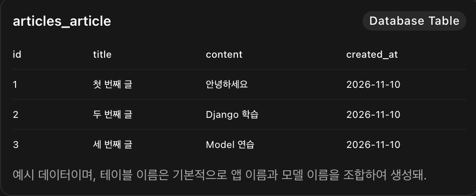

Python의 `Article` 클래스가 데이터베이스의 `articles_article` 테이블에 대응

### Model을 데이터베이스에 반영하는 방법

**Model 클래스를 작성**했다고 해서 데이터베이스에 **테이블이 즉시 생성되는 것 아님**

**Migrations(마이그레이션)** 과정을 거쳐야 함

#### 1단계 : 마이그레이션 파일 생성

```bash
python manage.py makemigrations
```
- **Model의 변경 사항을 분석**하여 마이그래이션 파일 생성


#### 2단계 : 마이그레이션 적용

```bash
python manage.py migrate
```
- **마이그레이션**을 데이터베이스에 **적용**하여 **테이블을 생성하거나 구조**를 변경

### Django Model로 데이터 관리하기

```python
from articles.models import Article

# CREATE : 데이터 생성
Article.objects.create(
    title = '첫 번째 게시글',
    content = 'Django Model 학습'
)

# READ : 전체 데이터 조회
articles = Article.objects.all()

# READ : 특정 데이터 조회
article = Article.objects.get(pk=1)

# UPDATE : 데이터 수정
article.title = '수정된 제목'
article.save()

# DELETE : 데이터 삭제
article.delete()
```
- `objects` 는 Django Model의 기본 Manger이며, 이를 통해 QuerySet API를 사용하여 데이터베이스를 조회하거나 조작할 수 있음

### 핵심 정리

|구분|설명|
|---|---|
|Model|데이터베이스의 **테이블 구조를 Python 클래스로 정의**|
|`models.Model`|Django Model을 정의하기 위한 기본 클래스|
|Model Field|데이터베이스 테이블의 열을 정의|
|Model Instance|데이터베이스 테이블의 행에 대응하는 객체|
|Migrations|Model의 구조 변경을 데이터베이스에 반영하는 과정|
|ORM|Python 객체를 통해 데이터베이스를 조작하는 기술|
|QuerySet API|데이터베이스의 데이터를 조회하고 조작하는 인터페이스|

Django Model은 데이터베이스의 테이블 구조를 Python 클래스로 표현하며, ORM을 통해 SQL을 직접 작성하지 않고도 데이터를 관리할 수 있게 해주는 구성 요소

**Model 정의 -> Migrations 적용 -> ORM을 통한 데이터 조작**

<br>

## 22. Django Model Class (모델 클래스)

Model Class는 Django에서 데이터베이스 **테이블의 구조를 정의**하기 위해 작성하는 **Python 클래스**

Django에서는 `django.db.models.Model` 클래스를 상속받아 Model Class를 정의

**Model Class 내부**에는 데이터베이스에 저장할 **데이터의 종류와 속성을 정의**하는 Model Field(모델 필드) 작성

### Model Class 정의 방법

일반적으로 **각 앱의 `models.py` 파일**에 Model Class 작성


### Model Class와 데이터베이스 테이블의 관계


|Python Model Class|Database|
|---|---|
|`Article` 클래스|`articles_article` 테이블|
|`Article` 인스턴스|테이블의 하나의 행(Row)|
|`title` 필드|`title` 컬럼|
|`content` 필드|`content` 컬럼|

- Model Class를 정의했다고 데이터베이스 테이블이 바로 생성되는 것 아님
- `makemigrations` 와 `migrate` 명령어를 통해 Model Class 구조를 데이터베이스에 반영해야 함

### Model Class와 Model Instance 차이

#### Model Class

데이터베이스에 저장할 **데이터의 구조를 정의**하는 클래스

#### Model Instance

**Model Class를 기반**으로 생성된 하나의 **Python 객체**

```python
article = Article(
  title = 'Django 학습',
  content = 'Model Class 학습 중'
)

article.save()
```
1. `Article(...)` 을 호출하여 Model Instance 생성
2. `title`, `content` 필드에 값 설정
3. `article.save()` 호출하여 데이터베이스에 저장

즉, **Model Class는 데이터 구조**를 정의, **Model Instance는 실제 데이터를 담는 객체**

Model Instance를 생성하는 것만으로 데이터베이스에 저장되지는 않음.
`save()` 를 호출해야 데이터베이스에 저장됨

### Model Class 의 특징
- **Python 클래스로 정의** : 별도의 SQL 테이블 생성문 없이 Python 코드로 데이터베이스 구조 정의 
- **`models.Model` 상속** : **Django ORM 기능**을 제공받아 **데이터베이스 조작 가능**
- **필드 정의** : `CharField`, `IntegerField`, `DateTimeField` 등을 사용하여 데이터의 종류와 속성을 정의
- **기본 키 자동 생성** : 별도의 기본 키를 정의하지 않으면 Django가 **일반적으로 id 필드를 자동으로 생성**
- **데이터베이스 테이블과 연결** : 기본적으로 하나의 **구체적인 Model Class**는 **하나의** 데이터베이스 **테이블에 대응**

### 핵심 정리

|구분|설명|
|---|---|
|Model Class|데이터베이스 테이블의 구조를 정의하는 Python 클래스|
|`models.Model`|Django Model Class가 상속받는 기본 클래스|
|Model Field|테이블의 컬럼에 대응하는 클래스 속성|
|Model Instance|Model Class를 기반으로 생성한 데이터 객체|
|Migrations|Model Class의 구조를 데이터베이스에 반영|

Django Model Class는 `models.Model` 을 상속받아 데이터베이스 테이블의 구조를 Python 코드로 정의하는 클래스

- Model Class = 데이터 구조 정의
- Model Instance = 실제 데이터를 담는 객체
- Database Table = 데이터가 저장되는 공간
